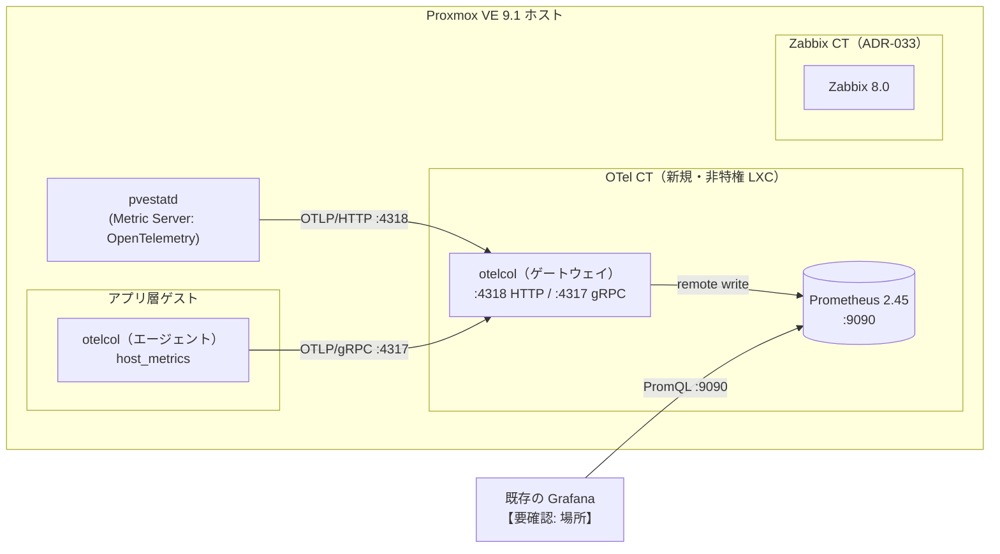

# OpenTelemetry 導入手順（Proxmox VE 9.1 / Ubuntu 24.04 LXC / OTel Collector 0.164 / Prometheus 2.45）

- **ステータス**: 下書き。**この手順はまだ誰も実機で通していない**。設定ファイルを `otelcol validate` で検査したこともない（[ADR-034](../adr/031-040/034-opentelemetry-introduction.md) の「未検証」）。最初に通した人が、つまずいた点を [zabbix-lessons.md](zabbix-lessons.md) の「OpenTelemetry」の欄に書き、この手順を直す。
- **作成日**: 2026-11-06
- **前提の決定**: [ADR-034](../adr/031-040/034-opentelemetry-introduction.md)（Zabbix 8.0 と並行して入れ、役割を分ける）
- **関連**: [Zabbix 構成案](zabbix-architecture.md) / [監視設計](monitoring-design.md) / [Zabbix セットアップ手順](zabbix-setup.md)

---

## 1. 何のために入れるか

Zabbix は「決めた条件を満たしたら知らせる」道具で、何を見るかを人が先に決める。
OpenTelemetry（以下 OTel）は、**データの取り方と運び方の標準**で、取ったデータをどこへ送るか（Prometheus・Zabbix・SaaS）を後から変えられる。

| | Zabbix 8.0（ADR-033） | OpenTelemetry（この手順） |
|---|---|---|
| 役割 | 判断して**知らせる**（トリガー・依存関係・通知） | **集めて運ぶ**（Collector）。眺めるのは Grafana |
| 見るもの | 前提の崩れ（venv・OS バージョン・再起動の繰り返し）、サービスの死活、外形 | Proxmox ホストと全ゲストの資源の推移、アプリ層ゲストの OS の指標 |
| 通知 | **出す**（通知は Zabbix に一本化。ADR-033） | **出さない**（同じ障害で 2 通来るのを避ける） |

さくらインターネットも、ネットワーク機器と物理サーバーは Zabbix で見続け、マイクロサービスのメトリクスを OTel Collector で集め直している（[さくらのIaaS基盤のモニタリングとOpenTelemetry](https://knowledge.sakura.ad.jp/45164/)、2025-07-30）。この手順は、それを自宅の規模で同じように分けて試すためのもの。

## 2. 構成



段階に分けて進める。**段階 1 だけで「Collector を 1 つ立て、Proxmox の値を Grafana に出す」が満たせる。**

| 段階 | 内容 | 手順 | 本番に触れるか |
|---|---|---|---|
| **1** | Proxmox → Collector → Prometheus → Grafana | 手順 0〜6 | 触れない（Proxmox の設定に送信先を 1 つ足すだけ） |
| 2 | アプリ層ゲストに Collector（エージェント）を入れ、OS の指標を送る | 手順 7 | **触れる**（パッケージを 1 つ入れる） |
| 3 | Bot・webapp・bridge を OTel SDK で計装し、トレースを取る | 9 章（概要のみ） | 触れる（コード変更。別の ADR） |
| 4 | Zabbix 8.0 の APM で OTel のデータを Zabbix に入れて比べる | 10 章（概要のみ） | 触れない。ただし ClickHouse が増える |

## この手順の使い方

- 各ステップに **確認方法** がある。確認が通るまで次に進まない。
- `<...>` はプレースホルダ。秘密の値は、このファイルにも、コミットにも、チャットにも書かない（この手順では秘密の値は出てこない）。
- `【要確認】` は、リポジトリや公式ドキュメントから確かめきれなかった点。
- 手順の区切りで `pct snapshot` を取る。

### プレースホルダの一覧（手順 0 で決める）

| プレースホルダ | 意味 |
|---|---|
| `<OTEL_CTID>` | OTel CT の VMID【要確認: 空いている番号】 |
| `<OTEL_IP>` / `<GW_IP>` / `<PREFIX>` | OTel CT の固定 IP・ゲートウェイ・プレフィックス長 |
| `<PVE_IP>` | Proxmox ホストの LAN 側の IP（pvestatd がここから送ってくる） |
| `<APP_IP>` | アプリ層ゲストの IP（段階 2） |
| `<GRAFANA_IP>` | 既存の Grafana が動いているゲストの IP【要確認: 構成案 Q6】 |
| `<STORAGE>` / `<BRIDGE>` / `<LAN_CIDR>` | Zabbix の手順と同じ |

---

## 手順 0: 事前確認（読み取りのみ。何も変えない）

Proxmox ホストで:

```bash
pveversion                                  # pve-manager/9.x（OpenTelemetry の送信は 9 から）
pvesh get /cluster/metrics/server           # いま登録されている送信先（たぶん空）
free -h
```

やること:

1. **既存の Grafana がどこで動いていて、データソースが何か**を確かめる（[Zabbix 構成案](zabbix-architecture.md) Q6）。Grafana が Prometheus をデータソースにできれば、この手順の Prometheus をそのまま足せる。
2. メモリの余裕: OTel CT に **1024 MiB** 使う。Zabbix CT（2048 MiB）と合わせて 3 GiB 余るかを確かめる。
3. Proxmox ファイアウォールがデータセンターのレベルで有効になっているかを確かめる（構成案 Q7）。**有効なら、手順 3 で Collector を入れる前に手順 8 のルールを入れておく**（理由は手順 3）。

**確認方法**: `pveversion` が 9 以上。Q6 が埋まっている。

---

## 手順 1: OTel 用の非特権 LXC を作る

```bash
# Proxmox ホストで。テンプレートは Zabbix の手順 1 で取ったものを使う
pct create <OTEL_CTID> local:vztmpl/<ubuntu-24.04 のテンプレートのファイル名> \
  --hostname otel \
  --cores 1 \
  --memory 1024 \
  --swap 256 \
  --rootfs <STORAGE>:8 \
  --net0 name=eth0,bridge=<BRIDGE>,ip=<OTEL_IP>/<PREFIX>,gw=<GW_IP>,firewall=1 \
  --unprivileged 1 \
  --features nesting=1 \
  --onboot 1 \
  --password

pct start <OTEL_CTID>
pct enter <OTEL_CTID>
```

- **Zabbix CT に同居させない**: 「Zabbix と OTel を比べる」ために、片方を止めても、もう片方に影響しないようにする。メモリの取り合いで比べた結果がゆがむのも避ける。
- `--memory 1024`: Collector は `memory_limiter` で 200 MiB に抑える（手順 4）。残りを Prometheus と OS に回す。見込みであって実測ではないので、1 週間後に `free -m` で見直す。
- `--rootfs 8`: Prometheus に入るのは、ホスト 1 台とゲスト数台の指標で数千系列の見込み。30 日保持でも 1 GiB を大きく下回る見込み【要確認: 1 週間後に `du -sh /var/lib/prometheus` で実測】。

```bash
# otel#
apt update && apt full-upgrade -y
timedatectl set-timezone Asia/Tokyo
```

**確認方法**:

```bash
pct config <OTEL_CTID>                   # unprivileged: 1 / memory: 1024 / onboot: 1
# otel#
grep VERSION_ID /etc/os-release          # "24.04"
ip -4 addr show eth0                     # <OTEL_IP>
timedatectl                              # System clock synchronized: yes（時刻がずれると指標の時刻もずれる）
```

```bash
pct snapshot <OTEL_CTID> o1-base --description "Ubuntu 24.04 + full-upgrade"
```

---

## 手順 2: Prometheus を入れる（受け口）

```bash
# otel#
apt install -y --no-install-recommends prometheus
```

- **apt 版（2.45.3）を使う**: Ubuntu のセキュリティ更新が `apt` で届く。最新版（3.x）は公式のバイナリを手で置くことになり、更新を自分で追う必要がある。
- `--no-install-recommends`: 推奨パッケージの `prometheus-node-exporter` を入れない。ホストの指標は Collector の `host_metrics` で取るので、同じものを二重に取らない。
- 2.45 は OTLP を直接受け取れない（3.x の機能）。代わりに **remote write の受け口**（`--web.enable-remote-write-receiver`）を有効にし、Collector から remote write で送る。この受け口があることは、apt 版のバイナリで確かめた（2026-11-06）。

起動オプション（`/etc/default/prometheus` はパッケージの既定で `ARGS=""` だけ）:

```bash
# otel#
cp /etc/default/prometheus /etc/default/prometheus.orig
cat > /etc/default/prometheus <<'EOF'
# 根拠: docs/monitoring/opentelemetry-setup.md 手順 2
ARGS="--web.listen-address=<OTEL_IP>:9090 --web.enable-remote-write-receiver --storage.tsdb.retention.time=30d"
EOF
```

- `--web.listen-address=<OTEL_IP>:9090`: 既定は全インターフェイス（`:9090`）。この CT の NIC は 1 つなので結果は同じだが、どこで待ち受けているかを設定ファイルに書いておく。
- `--web.enable-remote-write-receiver`: **このポートに届く相手は、誰でも書き込める**。Prometheus 2.45 には認証がない。だから手順 8 で 9090 に届く相手を `<GRAFANA_IP>` と CT 自身に絞る。
- `--storage.tsdb.retention.time=30d`: 既定は 15 日。月に一度の振り返り（[zabbix-lessons.md](zabbix-lessons.md)）で 1 か月分を見たいので 30 日にする。

パッケージの既定の `/etc/prometheus/prometheus.yml` は、入っていない Alertmanager（`localhost:9093`）と node exporter（`localhost:9100`）を見に行く。自分自身だけを見る設定に置き換える:

```bash
# otel#
cp /etc/prometheus/prometheus.yml /etc/prometheus/prometheus.yml.orig
cat > /etc/prometheus/prometheus.yml <<'EOF'
# 根拠: docs/monitoring/opentelemetry-setup.md 手順 2
# データは Collector から remote write で届く。ここで scrape するのは Prometheus 自身だけ。
global:
  scrape_interval: 60s
scrape_configs:
  - job_name: prometheus
    static_configs:
      - targets: ['<OTEL_IP>:9090']
EOF
promtool check config /etc/prometheus/prometheus.yml
systemctl restart prometheus
```

**確認方法**:

```bash
# otel#
systemctl is-active prometheus                                   # active
ss -tlnp | grep 9090                                             # <OTEL_IP>:9090
curl -s http://<OTEL_IP>:9090/-/ready                            # Prometheus Server is Ready.
journalctl -u prometheus -n 20 --no-pager | grep -i remote       # remote write receiver が有効になった旨の行【要確認: 2.45 のログの文言】
```

`systemctl is-active` が `failed` で、`journalctl -u prometheus` に名前空間（namespace）や `PrivateUsers` の失敗が出ていたら、パッケージのユニットファイルの防御設定（`PrivateUsers=true` など）が非特権 LXC で使えていない【要確認: `nesting=1` で動くか】。そのときは上書き用のファイルで外す（パッケージのファイルは直接書き換えない）:

```bash
# otel#  ※失敗したときだけ
systemctl edit prometheus      # [Service] の下に PrivateUsers=false と書いて保存
systemctl restart prometheus
```

---

## 手順 3: OTel Collector を入れる

**`contrib` 版（全部入り）ではなく、コア版の `otelcol` を使う。** この手順で使う部品（`otlp` receiver・`host_metrics` receiver・`memory_limiter`・`batch`・`resource_detection` processor・`prometheus_remote_write` / `otlp_grpc` exporter）は、コア版の `manifest.yaml` にすべて入っている（v0.164.0 で確認）。部品が少ないほど、脆弱性の通知を読む範囲も狭くなる。さくらインターネットは、さらに OCB（Collector Builder）で必要な部品だけを組み込んでいる。それは次の課題にする（11 章）。

Collector には apt リポジトリがない。GitHub のリリースから deb を取り、**チェックサムを照合してから**入れる。

```bash
# otel#
cd /tmp
V=0.164.0
wget https://github.com/open-telemetry/opentelemetry-collector-releases/releases/download/v${V}/otelcol_${V}_linux_amd64.deb
wget https://github.com/open-telemetry/opentelemetry-collector-releases/releases/download/v${V}/otelcol_${V}_linux_amd64.deb.sha256
echo "$(cat otelcol_${V}_linux_amd64.deb.sha256)  otelcol_${V}_linux_amd64.deb" | sha256sum -c
# → otelcol_0.164.0_linux_amd64.deb: OK
```

- `.sha256` のファイルには**ハッシュ値だけ**が入っている（ファイル名がない）。だから `sha256sum -c` にそのまま渡せず、上のように組み立てる。
- 2026-11-06 に確かめた v0.164.0 の amd64 の deb の SHA-256 は `73312676234dd202ab0b8685eed87ffda26e5da09affebb78df663532d400cb2`。
- 署名（`.sigstore.json`）もリリースに付いている。`cosign` での検証は次の課題にする【要確認: 検証のコマンド】。

### パッケージの癖: 入れた瞬間に、既定の設定で起動する

deb の中身を確かめた結果（v0.164.0、2026-11-06）:

- `preinst` がシステムユーザー `otel` を作る。
- `postinst` が `systemctl enable otelcol.service` と `systemctl restart otelcol.service` を実行する。**つまり、入れた瞬間に既定の `/etc/otelcol/config.yaml` で起動する。**
- 既定の設定は、`otlp`（4317・4318）・`jaeger`（14250・6831・6832・14268）・`zipkin`（9411）・`pprof`（1777）・`zpages`（55679）を **すべて `0.0.0.0` で待ち受ける**。`pprof` と `zpages` はデバッグ用で、外から触れてよいものではない。

そこで、**先に自分の設定ファイルを置いてから、`--force-confold`（既にある設定ファイルを残す）を付けて入れる**。手順 4 の設定を、先に `/etc/otelcol/config.yaml` として書いておく:

```bash
# otel#
mkdir -p /etc/otelcol
# ここで手順 4 の config.yaml を /etc/otelcol/config.yaml に書く
dpkg -i --force-confold otelcol_${V}_linux_amd64.deb
```

【要確認: パッケージの持ち物ではない設定ファイルが既にあるときに、`--force-confold` で確実に残るか】。下の確認で、既定の設定で起動していないことを必ず確かめる。手順 0 でデータセンターのファイアウォールが有効だった場合は、手順 8 のルール（Input Policy を DROP）を先に入れておけば、万一既定の設定で起動しても外からは届かない。

**確認方法**:

```bash
# otel#
dpkg -l otelcol | tail -1                           # ii  otelcol  0.164.0
id otel                                             # uid=... (otel)
otelcol validate --config=/etc/otelcol/config.yaml  # 何も出さずに終了コード 0
systemctl is-active otelcol                         # active
ss -tlnp | grep otelcol
# → <OTEL_IP>:4318、<OTEL_IP>:4317、127.0.0.1:13133、127.0.0.1:8888 の 4 つだけ。
#   1777・55679・14250・9411 などが出ていたら、既定の設定で動いている。すぐに systemctl stop otelcol
```

```bash
pct snapshot <OTEL_CTID> o2-installed --description "prometheus 2.45 + otelcol 0.164.0"
```

---

## 手順 4: Collector の設定（ゲートウェイ）

`/etc/otelcol/config.yaml`:

```yaml
# 根拠: docs/monitoring/opentelemetry-setup.md 手順 4、ADR-034
extensions:
  health_check:
    endpoint: 127.0.0.1:13133

receivers:
  otlp:
    protocols:
      http:
        endpoint: <OTEL_IP>:4318   # Proxmox（pvestatd）から
      grpc:
        endpoint: <OTEL_IP>:4317   # アプリ層ゲストの Collector から（段階 2）

processors:
  memory_limiter:
    check_interval: 1s
    limit_mib: 200
    spike_limit_mib: 50
  batch: {}

exporters:
  prometheus_remote_write:
    http:
      endpoint: http://<OTEL_IP>:9090/api/v1/write
      tls:
        insecure: true
    max_batch_request_parallelism: 1
    resource_constant_labels:
      included: ["*"]
  debug:
    verbosity: basic

service:
  telemetry:
    metrics:
      readers:
        - pull:
            exporter:
              prometheus:
                host: 127.0.0.1
                port: 8888
  extensions: [health_check]
  pipelines:
    metrics:
      receivers: [otlp]
      processors: [memory_limiter, batch]
      exporters: [prometheus_remote_write, debug]
```

設定ごとの理由:

- **受けるのはメトリクスだけ**（`pipelines` は `metrics` のみ）。トレースとログは段階 3 で足す。使わない受け口（jaeger・zipkin）は書かない。書かなければポートも開かない。
- **`otlp` の待ち受けを `<OTEL_IP>` にする**（既定の設定の `0.0.0.0` にしない）。この CT の NIC は 1 つだが、「どこで受けているか」を設定に残す。
- **`health_check` と Collector 自身のメトリクス（8888）は `127.0.0.1`**: CT の中から見られれば足りる。
- **`memory_limiter` を processors の先頭に置く**: Proxmox が大量に送ってきても、Collector が CT のメモリ（1024 MiB）を食いつぶして Prometheus ごと落ちないようにする。上限 200 MiB、急増分 50 MiB（README の目安「上限の 20%」に近い値）。上限を超えると、受け取りを断って送り手に再送させる。
- **`prometheus_remote_write`**（v0.164 での名前。古い名前 `prometheusremotewrite` も別名として使えるが、非推奨の警告が出る）:
  - `http.endpoint`: README は、最上位に `endpoint` を書く古い書き方より、`http:` の下に書くことを勧めている。
  - `tls.insecure: true`: この exporter は既定で TLS を求める。送り先は同じ CT の Prometheus で、平文の HTTP で受けている。
  - **`max_batch_request_parallelism: 1`**: 既定は 5 並列で送る。Prometheus 2.45 は既定で「時刻が前後したサンプル」を受け付けない。README は、受け付けない送り先には 1 にするよう書いている。
  - `resource_constant_labels.included: ["*"]`: Proxmox が付けてくるリソース属性（どのノード・どのゲストか）を、Prometheus のラベルにする。これがないと、ゲストごとの区別がつかない。古い書き方の `resource_to_telemetry_conversion` は非推奨になった（v0.164 の README）。
- **`debug` を `verbosity: basic` で残す**: 手順 5 で「何が届いているか」を `journalctl` で見るため。動作を確かめたら外す（手順 6 の最後）。

```bash
# otel#
otelcol validate --config=/etc/otelcol/config.yaml && systemctl restart otelcol
```

**確認方法**:

```bash
# otel#
curl -s http://127.0.0.1:13133/                     # {"status":"Server available", ...}【要確認: 0.164 の応答の形】
curl -s http://127.0.0.1:8888/metrics | grep -E '^otelcol_process_memory_rss' # Collector 自身のメモリ
journalctl -u otelcol -n 30 --no-pager              # error がない。deprecated の警告もない（あれば名前を直す）
```

---

## 手順 5: Proxmox から OTel Collector へ送る

Proxmox VE 9 の **Metric Server** に OpenTelemetry が加わった。`pvestatd` がホスト・ゲスト・ストレージの統計を、定期的に OTLP/HTTP で送る。**Proxmox ホストにエージェントを入れなくてよい。** Zabbix の手順で「ホストにはエージェントを入れない」と決めたことと合う。

API の定義（`pve-docs/api-viewer`、2026-11-06 に確認）:

| 項目 | 既定値 | この手順の値 | 理由 |
|---|---|---|---|
| `type` | — | `opentelemetry` | |
| `server` / `port` | （必須） | `<OTEL_IP>` / `4318` | OTLP/HTTP の既定のポート |
| `otel-protocol` | `https` | **`http`** | Collector 側に証明書を用意していない。LAN の中だけを流れ、中身は資源の数値だけ。TLS は 11 章の課題 |
| `otel-path` | `/v1/metrics` | 既定のまま | Collector の `otlp` receiver の HTTP の既定のパスと同じ |
| `otel-compression` | `gzip` | 既定のまま | `otlp` receiver は gzip を受けられる |
| `otel-timeout` | 5 秒（1〜10） | 既定のまま | |
| `otel-verify-ssl` | 1 | （http なので関係ない） | |

Web UI なら *Datacenter → Metric Server → Add → OpenTelemetry*。CLI なら（Proxmox ホストで）:

```bash
pvesh create /cluster/metrics/server/otel --type opentelemetry --server <OTEL_IP> --port 4318 --otel-protocol http
cat /etc/pve/status.cfg     # opentelemetry: otel の節ができている
```

- 公式の管理ガイドの External Metric Server の章は、2026-11-06 の時点で、対応先に OpenTelemetry を挙げているが、設定項目の説明は Graphite と InfluxDB の分しかない。上の表は API の定義から書いた。
- 送る間隔は、ほかの Metric Server と同じく `pvestatd` の周期【要確認: 秒数。第三者の解説は 10 秒としている】。

**確認方法**:

```bash
# otel#  届いたか（debug exporter の出力）
journalctl -u otelcol --since "2 min ago" --no-pager | grep -E 'ResourceMetrics|metrics' | tail
# otel#  Prometheus に入ったか。メトリクス名の一覧を出す
curl -s http://<OTEL_IP>:9090/api/v1/label/__name__/values | tr ',' '\n' | head -50
```

**届いたメトリクスの名前とラベルを、このファイルの末尾の「届いたメトリクス」の表に書き写す。** Proxmox が送る名前は、公式ドキュメントに一覧がない【要確認】。名前が分からないまま Grafana のダッシュボードを作ると、あとで全部作り直すことになる。

---

## 手順 6: Grafana に出す

既存の Grafana（`<GRAFANA_IP>`）に、データソースを 1 つ足す。

1. *Connections → Data sources → Add data source → Prometheus*
2. URL: `http://<OTEL_IP>:9090`。認証はなし（Prometheus 2.45 に認証がないので、手順 8 の経路の制限で守る）
3. *Save & test*

ダッシュボード:

- まず自分で 3 枚だけ作る: **ホストの CPU・メモリ**、**ゲストごとのメモリ**、**ストレージの使用率**。
- 公開されている「Proxmox VE Dashboard」（Grafana.com の ID 23855）は、Proxmox 9 の OpenTelemetry の送信を前提にしている、と説明に書かれている【要確認: どのデータソース（Prometheus か）向けか、メトリクス名が手順 5 で見たものと合うか】。合わなければ使わない。

**アラートは Grafana に設定しない**（通知は Zabbix に一本化。ADR-033）。

**確認方法**: Grafana のダッシュボードに、Proxmox ホストの値が 10 分以上途切れずに出ている。`pct stop` などでゲストを 1 つ止めると、そのゲストの線が途切れる（Proxmox から送られる値が止まる）。

確かめたら、手順 4 の `exporters` から `debug` を外して `otelcol validate` → `systemctl restart otelcol`。

```bash
pct snapshot <OTEL_CTID> o3-stage1 --description "段階 1 完了: PVE -> otelcol -> prometheus -> grafana"
```

**ここまでで段階 1 が終わる。**

---

## 手順 7（段階 2）: アプリ層ゲストに Collector（エージェント）を入れる

**本番に手を入れる手順。** 入れるのはパッケージ 1 つと設定ファイル 1 つで、アプリ（`infra/*.service`・`.env`・コード）には触れない。

Proxmox からの値は「外から見た」ゲストの資源。ゲストの中の OS から見た値（ファイルシステムごとの使用率・ロードアベレージ・ネットワーク）は、ゲストの中で取る。

手順 3 と同じく、**先に設定ファイルを置いてから** `dpkg -i --force-confold` で入れる。`/etc/otelcol/config.yaml`（アプリ層ゲスト）:

```yaml
# 根拠: docs/monitoring/opentelemetry-setup.md 手順 7、ADR-034
# このゲストでは何も待ち受けない（receivers は host_metrics だけ）
receivers:
  host_metrics:
    collection_interval: 60s
    scrapers:
      cpu: {}
      load: {}
      memory: {}
      filesystem: {}
      network: {}
      paging: {}

processors:
  memory_limiter:
    check_interval: 1s
    limit_mib: 100
    spike_limit_mib: 25
  resource_detection:
    detectors: [system]
    system:
      hostname_sources: [os]
  batch: {}

exporters:
  otlp_grpc:
    endpoint: <OTEL_IP>:4317
    tls:
      insecure: true

service:
  telemetry:
    metrics:
      level: none
  pipelines:
    metrics:
      receivers: [host_metrics]
      processors: [memory_limiter, resource_detection, batch]
      exporters: [otlp_grpc]
```

- **このゲストでは何も待ち受けない**: `otlp` receiver も `health_check` も置かない。本番のゲストに開くポートを増やさない。Collector 自身のメトリクスも `level: none` で出さない（8888 を開かない）。
- **`collection_interval: 60s`**: Zabbix の監視設計の多くの項目と同じ 1 分にして、比べやすくする。
- **`process` スクレイパーは入れない**: プロセスごとの指標は、`otel` ユーザーでは読めないプロセスがあり、エラーが続く。どのプロセスが生きているかは Zabbix（`Systemd by Zabbix agent 2`）で見ている。
- **`resource_detection` の `hostname_sources: [os]`**: 既定は `dns` が先。自宅の LAN の DNS がゲスト名を引けるかは分からない【要確認】ので、OS のホスト名を使う。
- **`memory_limiter` を 100 MiB**: 本番のゲストで、Collector がアプリのメモリを奪わないように、ゲートウェイより小さくする。
- **`otlp_grpc` を `insecure: true`（平文）にする**: LAN の中だけを流れ、中身は OS の数値だけ。TLS は 11 章の課題。
- **アプリ層ゲストが LXC の場合**: CT の中から見える CPU やメモリは、lxcfs によって CT の割り当てに合わせた値になることが多い【要確認: 構成案 Q1 でアプリ層が LXC と分かったら、`free -m` と Grafana の値を見比べる】。

**確認方法**:

```bash
# アプリ層ゲストで
otelcol validate --config=/etc/otelcol/config.yaml
systemctl is-active otelcol                       # active
ss -tlnp | grep otelcol                           # 何も出ない（待ち受けていない）
ps -o rss=,cmd= -C otelcol                        # RSS が 100 MiB 前後で収まっている
# otel#
curl -s 'http://<OTEL_IP>:9090/api/v1/query?query=count(system_memory_usage_bytes)' # 1 以上【要確認: 変換後の名前】
```

---

## 手順 8: Proxmox ファイアウォールで経路を絞る

Zabbix の手順 12 と同じ注意（設定を誤ると Proxmox の Web UI や SSH に入れなくなる。先に 8006 と 22 を許可してから有効にする）。

| 対象 | 方向 | 許可 | 送信元 | 理由 |
|---|---|---|---|---|
| OTel CT | IN | TCP 4318 | `<PVE_IP>` のみ | Proxmox からの送信。ほかの誰かが偽の値を送り込めないように |
| OTel CT | IN | TCP 4317 | `<APP_IP>`（段階 2 から） | アプリ層ゲストの Collector から |
| OTel CT | IN | TCP 9090 | `<GRAFANA_IP>` のみ | **9090 は remote write の書き込みも受ける**（手順 2）。届く相手を Grafana に絞る |
| OTel CT | IN | TCP 22 | `<LAN_CIDR>`（SSH を使う場合のみ） | |
| OTel CT | IN | それ以外 | 拒否（Input Policy を DROP） | |
| アプリ層ゲスト | OUT | — | — | 追加のルールは不要（OUT は既定で許可）【要確認: OUT の既定の方針】 |

`<GRAFANA_IP>` が OTel CT 自身なら、9090 の許可は要らない（CT の中で完結する）。

**確認方法**:

```bash
# LAN 内の別の PC から（Grafana のゲストではないところから）
timeout 3 bash -c '</dev/tcp/<OTEL_IP>/9090' && echo OPEN || echo CLOSED   # CLOSED
timeout 3 bash -c '</dev/tcp/<OTEL_IP>/4318' && echo OPEN || echo CLOSED   # CLOSED
```

Grafana のダッシュボードの値が途切れていない（Proxmox・アプリ層ゲスト・Grafana からは届いている）。

---

## 9.（段階 3・概要）アプリを計装する

ここからはコードの変更になるので、**別の ADR を書いてから**やる。考えておくことだけ書く。

- **対象**: `discord_bot/webapp.py`（Quart）、`bot.py`（discord.py）、`database_bridge`（Rust）。webapp → bridge → MariaDB という 1 回のリクエストの流れを、1 本のトレースとしてつなげて見られるようになる。INC-001 のような 502 のときに、どこで止まったかを時刻つきで追える。
- **Python**: OpenTelemetry の Python SDK と、ASGI 向けの自動計装がある【要確認: Quart と hypercorn の組み合わせで使えるか、依存を増やしてよいか】。
- **Rust**: `opentelemetry` と `tracing-opentelemetry` クレート【要確認: bridge が使っている Web フレームワークとの組み合わせ】。
- **送り先**: アプリ層ゲストの Collector に `otlp` receiver を `127.0.0.1` だけで足し、そこからゲートウェイへ送る。トレースの保存先（Tempo・Jaeger など）は、まだ決めていない。**メモリ 16 GB のホストに、保存先を 1 つ足せるかを先に見積もる。**
- 「Bot が Discord の Gateway から切れている状態」（監視設計 D 章の「見えていないもの」）は、Bot の中からメトリクスを出せば見えるようになる。これがアプリを計装する、いちばん具体的な理由になる。

## 10.（段階 4・概要）Zabbix 8.0 の APM で OTel のデータを Zabbix に入れる

Zabbix 8.0 で、OTel のデータ（トレース・メトリクス・ログ）を Zabbix で扱う **APM** の機能が入った。2026-11-06 に 8.0.0 のパッケージの設定ファイルと公式ドキュメントで確かめた仕組み:

| 部品 | 役割 | 設定（既定値） |
|---|---|---|
| **Zabbix proxy** | OTLP/**gRPC** を受け、テレメトリの DB に書く。**Zabbix server は OTLP を受けない** | `StartAPMCollector=1`（既定 0）、`APMListenPort`（既定 4317）、`APMListenIP`（既定 `0.0.0.0`）、`APMTLSCAFile` などで TLS |
| **ClickHouse** | テレメトリの保存先。**ClickHouse しか選べない** | proxy と server の両方に `TelemetryProvider=clickhouse;url=...,db=...` |
| Zabbix server | ClickHouse に問い合わせて、トリガーとグラフに使う | 新しいアイテム種別「Telemetry query」、`StartTelemetryQueryPollers` |
| Web UI | *Administration → Data source* でテレメトリの DB を指定。*APM* メニューで見る | |

- Ubuntu 24.04 では、APM の機能は proxy のパッケージ（例: `zabbix-proxy-sqlite3`）に含まれている（公式の「Package installation notes」）。8.0.0 の proxy のパッケージは、gRPC と protobuf のライブラリに依存している（`Depends` で確認）。
- テンプレート「Generic OpenTelemetry by OTLP」（Zabbix 8.0 以上）で、スパンのエラー率などにトリガーを掛けられる（<https://www.zabbix.com/integrations/opentelemetry>）。
- **やるとしたら**: ゲートウェイの Collector に `otlp_grpc` exporter をもう 1 つ足し、同じデータを Prometheus と Zabbix proxy の両方に送る。同じデータで「Grafana で眺める」と「Zabbix で判断する」を並べて比べられる。
- **重さ**: proxy と ClickHouse が増える。ClickHouse の必要メモリは、公式の ClickHouse の設定ページに書かれていない【要確認】。16 GB のホストに Zabbix・OTel と並べて置けるかを、段階 1・2 の実測を見てから判断する。**段階 3 のトレースがないうちは、APM の機能（トレースの解析）がほとんど活きない**ので、段階 3 より後にする。

## 11. 次の課題

- [ ] Collector を OCB（OpenTelemetry Collector Builder）で、使う部品だけを組み込んで作り直す（さくらインターネットの方針）
- [ ] `cosign` で deb の署名を検証する
- [ ] Proxmox → Collector と、アプリ層 → Collector を TLS にする
- [ ] Prometheus を 3.x にして、Collector から OTLP のまま送る（remote write をやめる）かを判断する
- [ ] Collector の更新の追い方（apt リポジトリがないので、GitHub のリリースを見る必要がある）

## 12. 比べる観点（面接で話すために）

導入後に、実際に使った感触で埋める。**盛らない。やっていないことは「やっていない」と書く。**

| 観点 | Zabbix 8.0 | OpenTelemetry + Prometheus |
|---|---|---|
| 入れるまでにつまずいたこと | | |
| Proxmox を見る方法 | API をポーリング（読み取り専用トークン） | Proxmox から押し出し（Metric Server） |
| 「前提の崩れ」（INC-001 型）を見られるか | UserParameter で見られる | 標準の部品では見られない。アプリの計装か、独自の receiver が要る |
| 異常の判断と通知 | トリガー・依存関係・通知 | この構成では持たない（Prometheus のアラートは使っていない） |
| データの送り先を変えるときの手間 | | Collector の exporter を足すだけ |
| CT のメモリ（実測） | | |

## ロールバック

### 途中でやり直す（OTel CT の中だけ）

```bash
pct stop <OTEL_CTID>
pct rollback <OTEL_CTID> <スナップショット名>   # o1-base / o2-installed / o3-stage1
pct start <OTEL_CTID>
```

### 全部やめる

上から順に行う。

| # | 消すもの | コマンド・操作 | 確認方法 |
|---|---|---|---|
| 1 | Proxmox の送信先 | `pvesh delete /cluster/metrics/server/otel` | `cat /etc/pve/status.cfg` に `opentelemetry` の節がない |
| 2 | Grafana のデータソースとダッシュボード | Grafana の UI で削除 | 一覧に残っていない |
| 3 | アプリ層ゲストの Collector（段階 2） | `systemctl disable --now otelcol` → `apt purge -y otelcol` → `rm -rf /etc/otelcol` → `userdel otel` | `dpkg -l \| grep otelcol` が空。`id otel` が失敗する |
| 4 | ファイアウォールのルール | 手順 8 でアプリ層ゲスト側に足したものがあれば消す（OTel CT のルールは CT ごと消える） | |
| 5 | OTel CT | `pct stop <OTEL_CTID>` → `pct destroy <OTEL_CTID> --purge 1` | `pct list` に出てこない |

- 本番のアプリ（`infra/*.service`・`.env`・コード）には、この手順のどこでも触れていない。
- Zabbix には触れていない。段階 4 をやっていた場合は、Zabbix proxy・ClickHouse の片付けを別に行う。

## 届いたメトリクス（手順 5・7 で埋める）

| 送り元 | メトリクス名（Prometheus 側） | 主なラベル | 意味 |
|---|---|---|---|
| Proxmox | | | |
| アプリ層ゲスト | | | |

## 出典（確認日はすべて 2026-11-06）

- Collector のリリース・deb の中身（`preinst`・`postinst`・既定の `config.yaml`・`otelcol.service`）: <https://github.com/open-telemetry/opentelemetry-collector-releases/releases/tag/v0.164.0>（deb を取得し `dpkg-deb` で確認）
- コア版の部品の一覧: <https://github.com/open-telemetry/opentelemetry-collector-releases/blob/main/distributions/otelcol/manifest.yaml>
- 各部品の名前（`metadata.yaml` の `type` と `deprecated_type`）と設定項目: `prometheus_remote_write`（<https://github.com/open-telemetry/opentelemetry-collector-contrib/tree/v0.164.1/exporter/prometheusremotewriteexporter>）、`otlp_grpc`（<https://github.com/open-telemetry/opentelemetry-collector/tree/v0.164.0/exporter/otlpexporter>）、`host_metrics`、`resource_detection`、`memory_limiter`、`health_check`
- Proxmox の Metric Server: <https://pve.proxmox.com/pve-docs/pve-admin-guide.html>（External Metric Server の章）、API の定義 <https://pve.proxmox.com/pve-docs/api-viewer/>（`/cluster/metrics/server/{id}`）
- Prometheus（Ubuntu noble の `prometheus` 2.45.3+ds-2ubuntu0.3）: パッケージを取得し、`/etc/default/prometheus`・ユニットファイル・既定の `prometheus.yml`・`--web.enable-remote-write-receiver` の有無を確認
- Zabbix 8.0 の APM: <https://www.zabbix.com/documentation/8.0/en/manual/introduction/whatsnew>、<https://www.zabbix.com/documentation/8.0/en/manual/installation/install/packages>、`zabbix-proxy-sqlite3` / `zabbix-server-mysql` 8.0.0 のパッケージの設定ファイル
- さくらインターネットの事例: <https://knowledge.sakura.ad.jp/45164/>、<https://knowledge.sakura.ad.jp/51163/>
