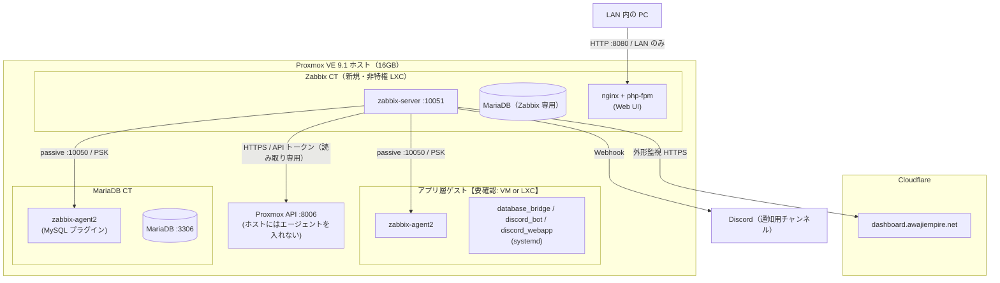

# Zabbix 構成案・セキュリティ方針・Grafana との関係

- **ステータス**: 下書き（未導入）
- **作成日**: 2026-11-05
- **関連**: [監視設計](monitoring-design.md) / [セットアップ手順](zabbix-setup.md) / [ADR-033](../adr/031-040/033-zabbix-monitoring-introduction.md)

---

## 1. いまの構成（リポジトリから読み取れること）

| 項目 | 内容 | 出典 |
|---|---|---|
| 物理サーバー | Core i3 9100F（4C/4T）、メモリ 16GB、SSD 500GB | `docs/ARCHITECTURE.md` §6.1 |
| ハイパーバイザ | Proxmox VE 9.1 | `docs/ARCHITECTURE.md` §6.1 |
| アプリ層（本番） | `database_bridge`（Rust, `127.0.0.1:7878`）/ `bot.py` / `webapp.py`（`0.0.0.0:5000`）の 3 プロセスを systemd で起動 | `infra/*.service`、`discord_bot/webapp.py:306`、ADR-028 |
| リバースプロキシ | nginx が `:80` で受けて `127.0.0.1:5000` へ | `infra/nginx-awaji.conf` |
| DB | MariaDB（アプリ層とは別の CT）。Ubuntu 24.04 の apt 版 `10.11.14` | `docs/ARCHITECTURE.md` §2、ADR-028 |
| 外部公開 | Cloudflare Tunnel で `dashboard.awajiempire.net` のみ。インバウンドのポートは開けていない | `docs/ARCHITECTURE.md` §6.2、ADR-029 |
| ドメイン・DNS | レジストラ・DNS・Tunnel・WARP はすべて Cloudflare | ADR-030 |
| デプロイ | GitHub Actions のセルフホストランナー。本番 `01sv-ubuntu`、テスト `02sv-testenv` | `.github/workflows/deploy.yml` |
| ヘルスチェック | `GET http://127.0.0.1:7878/health`（bridge が DB に問い合わせて結果を返す） | `database_bridge/src/api/mod.rs:32` |
| Web の入口の挙動 | 未ログインで `/` にアクセスすると `/login` へリダイレクト | `discord_bot/webapp.py:269-273` |

### 1.1 リポジトリ内で記述が食い違っている点・読み取れない点

推測で埋めず、【要確認】として残す。

| # | 内容 | 食い違い・不足 |
|---|---|---|
| Q1 | **アプリ層は VM か LXC か** | `ARCHITECTURE.md` と ADR-029 は「Ubuntu 24.04 LTS **VM**」、ADR-028 は「Proxmox 上の単一 **LXC** ホスト」と書いている。【要確認】`qm list` と `pct list` で確かめる |
| Q2 | **本番の OS バージョン** | `ARCHITECTURE.md`・ADR-029 は 24.04。INC-001 は**テスト環境**を 26.04 に上げた記録。本番が今も 24.04 か【要確認】 |
| Q3 | **テスト環境（`02sv-testenv`）の置き場所** | 同じ Proxmox ホスト上のゲストか、別マシンか【要確認】。メモリ見積もりに効く |
| Q4 | **各ゲストの VMID・IP・割り当てメモリ** | リポジトリに記録なし（ADR-016 に `192.168.50.69` という LAN の IP が 1 か所出てくるが、どのゲストかは書かれていない）【要確認】 |
| Q5 | **`cloudflared` がどこで動いているか** | アプリ層のゲスト上か、専用のゲストか【要確認】。Zabbix の Web UI を Tunnel で出す場合に効く |
| Q6 | **Grafana の構成** | 依頼の背景では「Grafana などでコンテナや VM の状態を見ている」とあるが、リポジトリに Grafana の記述はない。どのゲストで動いているか、データソースは何か、アラートを設定しているか【要確認】 |
| Q7 | **Proxmox ホスト自身のファイアウォール設定・ブリッジ名・ストレージ名** | 記録なし。CHANGELOG に「Proxmox ファイアウォールによる Web VM ↔ DB CT の遮断を解除」とあるのみ【要確認】 |
| Q8 | **本番の webapp の起動方法** | INC-001 のログは `hypercorn`、`infra/discord_webapp.service` は `python3 webapp.py`。現在どちらか【要確認】。監視項目には影響しないが、INC-001 の再発条件の理解に関わる |

確認用のコマンド（Proxmox ホストで実行。読み取りのみ）:

```bash
pveversion
qm list                      # VM の一覧（VMID・名前・状態・メモリ）
pct list                     # CT の一覧
pvesm status                 # ストレージ名と空き
free -h                      # ホスト全体のメモリ
for id in $(pct list | awk 'NR>1{print $1}'); do echo "CT $id"; pct config $id | grep -E '^(hostname|memory|swap|cores|net0)'; done
for id in $(qm list | awk 'NR>1{print $1}'); do echo "VM $id"; qm config $id | grep -E '^(name|memory|balloon|cores|net0)'; done
```

---

## 2. 構成の案

### 2.1 全体図



### 2.2 Zabbix サーバーの置き場所: 専用の非特権 LXC

| 案 | 評価 |
|---|---|
| **専用の非特権 LXC（推奨）** | VM より軽い（カーネルを持たない）。アプリ層・DB と分かれているので、Zabbix を壊しても消しても本番に影響しない。`pct snapshot` で手順の途中に戻れる |
| 専用の VM | 分離は強いが、ゲスト OS のカーネル分だけメモリを余計に使う。16GB のホストでは割に合わない |
| アプリ層のゲストに同居 | **不採用**。監視対象と監視する側が一緒に落ちる。INC-001 のように OS 更新でアプリ層が壊れたとき、監視も一緒に壊れる |
| Proxmox ホストに直接インストール | **不採用**。ハイパーバイザに Web サーバーと DB を足すと、ホストの更新（PVE のメジャーアップグレード）と Zabbix の依存関係が絡む |

OS は **Ubuntu 24.04 LTS** の LXC テンプレートにする。理由:

- 本番（`ARCHITECTURE.md` 上は 24.04）と揃えると、Ubuntu の癖を一つ覚えれば済む。
- Zabbix 公式リポジトリに 8.0 の `noble`（24.04）向けのパッケージがある（2026-11-06 に `repo.zabbix.com` で確認）。
- Ubuntu 24.04 の apt の MariaDB は 10.11 系で、Zabbix 8.0 のサポート範囲（10.11〜12.3）に入る（出典: 下記 2.4）。

### 2.3 Zabbix のバージョン: 8.0 LTS で始める（2026-11-06 に決定）

2026-11-05 時点の公式ライフサイクル（<https://www.zabbix.com/life_cycle_and_release_policy>）:

| バージョン | リリース日 | フルサポート終了 | 限定サポート終了 |
|---|---|---|---|
| **8.0 LTS** | **2026-11-05** | 2029-11-30 | 2031-11-30 |
| 7.4（非 LTS） | 2025-07-01 | 2026-11-12 | 2027-05-31 |
| 7.0 LTS | 2024-06-04 | 2027-06-30 | 2029-06-30 |

検討した案:

| 案 | 長所 | 短所 |
|---|---|---|
| A. 7.0 LTS で始め、後で 8.0 へ上げる | 手順と情報が揃っている。7.0 → 8.0 の作業が「リプレイス」の練習になる | 2027-06-30 までに上げる作業が必ず発生する |
| **B. 8.0 LTS で始める（採用）** | サポートが 2029-11 / 2031-11 まで長く、上げ直しが要らない。**OpenTelemetry のデータを Zabbix で扱う機能（APM）が 8.0 から入った**ので、[OpenTelemetry 導入](opentelemetry-setup.md)と比べる材料になる | x.0.0 の不具合を踏む可能性がある。日本語の情報がまだ少ない |
| C. 8.0.1 以降を待つ | B の短所が減る | 始める時期が Zabbix 側の都合で決まる |

**B にした理由**: 2026-11-05 の時点で懸念していた「リポジトリ設定パッケージがプレリリース版で `stable` を指していない」問題が、翌日に解消していた（下記）。残る短所は x.0.0 の不具合だけで、これは手順の途中で `pct snapshot` を取って戻れるようにしてあるので受け入れる。

`repo.zabbix.com` を直接確かめた結果:

- **2026-11-06**: `zabbix-release_latest_8.0+ubuntu24.04_all.deb` の中身は `1:8.0-0.5+ubuntu24.04`。`.sources` は `https://repo.zabbix.com/zabbix/8.0/stable/ubuntu` と `.../8.0/release/ubuntu` を有効にし、`.../8.0/unstable/ubuntu` は `Enabled: no`。あわせて `https://repo.zabbix.com/zabbix-tools/debian-ubuntu` も追加する。`stable` には `8.0.0-1+ubuntu24.04` のパッケージが出ている。
- 2026-11-05（前日）: 同じパッケージは `1:8.0-0.4+ubuntu24.04` で、`release` と `unstable` を指し、`stable` を指していなかった。**入れる直前に、もう一度 `.sources` の中身を確かめる**（セットアップ手順 2）。
- 7.0 と 8.0 では SQL スクリプトの置き場所が違う（7.0: `/usr/share/zabbix-sql-scripts/mysql/server.sql.gz`、8.0: `/usr/share/zabbix/sql-scripts/mysql/server.sql.gz`。両方のパッケージの中身を `dpkg -c` で確認した）。**7.0 向けの記事の手順をそのまま 8.0 に当てると、ここで失敗する。**

### 2.4 DB の選択: Zabbix CT の中に専用の MariaDB を入れる

| 案 | 評価 |
|---|---|
| **Zabbix CT 内に専用の MariaDB（推奨）** | 監視対象（本番の MariaDB CT）が止まっても、監視の記録と通知は止まらない。Ubuntu 24.04 の apt の MariaDB 10.11 は、8.0 のサポート範囲（10.11.00〜12.3.X）に入る |
| 本番の MariaDB CT に `zabbix` DB を相乗り | **不採用**。「DB が落ちた」ことを、落ちた DB に書こうとすることになる。Zabbix は書き込みが多く、本番 DB の I/O とバッファプールを食い合う。本番 DB の権限設計にも手が入る |
| PostgreSQL（+ TimescaleDB） | 大規模では有利だが、このリポジトリは MariaDB の運用経験しかない。数百アイテムの規模では差が出ない。新しく覚えるものを Zabbix 本体に絞るため不採用 |

8.0 は MariaDB の下限を 10.11.00 に上げている。Ubuntu 24.04 の 10.11 はちょうど下限にいる。**Ubuntu の次の LTS へ上げずに Zabbix だけ 8.x の先へ上げ続けると、いつか下限を割る**。これも「前提の崩れ」の一つとして監視設計に入れた（monitoring-design.md C-6）。

出典:
- Zabbix 7.0 要件: <https://www.zabbix.com/documentation/8.0/en/manual/installation/requirements>
- Zabbix 8.0 要件: <https://www.zabbix.com/documentation/8.0/en/manual/installation/requirements>

### 2.5 リソースの見積もり

公式の要件ページの「Small」の例は **監視メトリクス 1,000 件で 2 vCPU / 8 GiB** だが、これは専用のサーバー 1 台の目安であり、「実際の必要量は有効なアイテム数と取得間隔で大きく変わる」と書かれている。この構成で見込むアイテム数は数百（ホスト 3〜4 台 + Proxmox API）。実際の数は導入後に *Reports → System information* の「Number of items」で確かめて、この節を書き換える。

| リソース | 初期値 | 根拠 |
|---|---|---|
| vCPU | 2 | 公式 Small の目安。LXC の `cores` は使える上限であって占有ではない |
| メモリ | **2048 MiB**（swap 512 MiB） | 内訳の見込み: MariaDB の `innodb_buffer_pool_size` を 512 MiB に絞る / zabbix-server 本体と各キャッシュで数百 MiB / nginx + php-fpm で 200 MiB 前後。**見込みであって実測ではない**。導入後 1 週間の実測（下記）で見直す |
| ディスク | 16 GiB | 公式の計算式（数値 1 値あたり約 90 バイト）で、300 アイテム × 60 秒間隔 × 履歴 7 日 ≒ 5 値/秒 × 604,800 秒 × 90 B ≒ **約 270 MB**。トレンド（1 時間ごとの集計）を 1 年持っても 300 × 8,760 × 90 B ≒ 約 240 MB。OS・パッケージ・ログ・余裕込みで 16 GiB |

**既存のサービスに影響しないか**の確かめ方（導入前に本人がやる）:

1. 1.1 の確認用コマンドで、いま各ゲストに割り当てているメモリの合計を出す【要確認】。
2. `16 GiB − 割り当ての合計 − Proxmox ホスト自身の分` が 2.5 GiB 以上残るか確かめる。ストレージが ZFS なら ARC の分も引く【要確認: ZFS か LVM-thin か】。
3. 残らない場合は、メモリ 1536 MiB・`innodb_buffer_pool_size` 256 MiB で始める。

導入後の見直し（1 週間後）:

- Zabbix CT の実メモリ（Proxmox の CT の Summary、または CT 内で `free -m`）
- **Zabbix server health** テンプレートのキャッシュ使用率（Configuration cache、History write cache など）が 80% を超えていないか
- Proxmox ホスト側の `free -h` で swap が増えていないか

---

## 3. セキュリティ方針

### 3.1 守る前提

- **自宅の IP を公開しない**（`ARCHITECTURE.md` §6.2、ADR-029 の前提）。Zabbix のためにルーターでポートを開けることはしない。
- **監視のための経路が、攻撃の入口を増やさない**。Zabbix は全ホストに話しかけられる立場になるので、Zabbix CT が乗っ取られた場合の被害を小さくする。

### 3.2 Web UI の見せ方

| 案 | 評価 |
|---|---|
| **A. LAN 内からのみ（推奨・最初はこれ）** | Zabbix CT の nginx を `:8080` で待ち受け、Proxmox ファイアウォールで LAN のセグメントからだけ許可する。インターネットからは届かない |
| B. Cloudflare Tunnel + Cloudflare Access（自己ホスト型・公開ホスト名） | 外出先から見られる。Access の認証が Zabbix のログインの手前に入る。Tunnel 経由なので IP は出ない。**Access を付けずに Tunnel だけで公開するのは禁止**（Zabbix のログイン画面がインターネットに直接さらされる） |
| C. Cloudflare One Client（WARP）+ プライベートネットワーク | 公開ホスト名を作らずに外から届く。WARP はロビー機能で既に使っている（ARCHITECTURE §6.2）ので、ロビー参加者向けの設定と混ざらないよう整理が要る |

**判断**: まず A で始める。外から見たくなったら B を別の ADR で決める（Access のポリシーを誰に許可するか、という判断が増えるため）。

出典:
- Cloudflare Access で守る Web アプリ: <https://developers.cloudflare.com/cloudflare-one/access-controls/applications/http-apps/>
- アプリの種類の選び方（公開ホスト名 / プライベート）: <https://developers.cloudflare.com/cloudflare-one/access-controls/applications/choose-application-type/>
- Tunnel への振り分け（Access のポリシーで守るには Access のシートが必要）: <https://developers.cloudflare.com/cloudflare-one/networks/connectors/cloudflare-tunnel/routing-to-tunnel/>

どの案でも Zabbix 側で必ずやること:

- 初期の `Admin` ユーザーのパスワードを、最初のログイン直後に変える。
- 自分用の管理ユーザーを作り、`Admin` は無効にする。
- **MFA（TOTP）を有効にする**。Zabbix は 7.0 から MFA（TOTP / Duo）がある（8.0 にもある）。*Users → Authentication* で有効にし、ユーザーグループ単位で割り当てる（出典: <https://www.zabbix.com/documentation/8.0/en/manual/web_interface/frontend_sections/users/authentication/mfa>）。
- ゲストユーザー（`guest`）が無効のままであることを確かめる。

### 3.3 エージェントとの通信

| 決めごと | 内容 | 理由 |
|---|---|---|
| 方式 | **パッシブチェック**（Zabbix サーバー → エージェントの `10050/TCP`）で始める | 公式テンプレート `Linux by Zabbix agent` がパッシブ前提。ログ監視（アクティブチェックが必要）は第 3 段階で追加する |
| 待ち受けの制限 | 各エージェントの `Server=` を Zabbix CT の IP だけにする | エージェントは `Server=` に書いた相手からの接続しか受けない |
| ファイアウォール | Proxmox ファイアウォールで `10050/TCP` を Zabbix CT の IP からのみ許可 | `Server=` は「接続を受けてから断る」。ファイアウォールは「そもそも届かない」。二重にする |
| 暗号化 | **PSK（事前共有鍵）で暗号化**。ホストごとに別の PSK | 監視データ（プロセス名・パッケージ一覧など）は攻撃者にとって偵察情報になる。ホストごとに分けると、1 台の PSK が漏れても他に波及しない |
| `system.run` | 有効にしない（`AllowKey=system.run[*]` を書かない） | 有効にすると Zabbix サーバーから任意のコマンドを実行できる。Zabbix CT を乗っ取られたとき全ホストの乗っ取りに直結する |
| UserParameter | 決め打ちのコマンドだけを書く（[monitoring-design.md](monitoring-design.md) 参照）。`UnsafeUserParameters=0`（既定）のまま | 引数にシェルの特殊文字を通さない |
| root で動かさない | エージェントは `zabbix` ユーザーで動く（パッケージの既定）。監視のために sudo 権限を与えない | INC-001 で問題になった `visudo -c` のように root が要る確認は、Zabbix ではなく手順書・CI 側で行う |

ポート（出典: 8.0 要件ページ「Default ports」）: エージェント / エージェント 2 は `10050/TCP`（サーバーから接続される）、サーバーは `10051/TCP`（アクティブエージェント・送信ツール・フロントエンドから接続される）。

PSK の仕様（出典: <https://www.zabbix.com/documentation/8.0/en/manual/security/using_pre_shared_keys>）:
- 生成: `openssl rand -hex 32`（256 ビット）。最小は 128 ビット（16 進 32 文字）。
- PSK ファイルは Zabbix ユーザーだけが読めるようにする。

### 3.4 認証情報の扱い

| 認証情報 | 置き場所 | ドキュメントに書くもの |
|---|---|---|
| Zabbix DB の `zabbix` ユーザーのパスワード | Zabbix CT の `/etc/zabbix/zabbix_server.conf`（`DBPassword=`）と Web UI のセットアップで生成される設定ファイル | `<ZABBIX_DB_PASSWORD>` |
| Zabbix Web UI の管理ユーザーのパスワード・TOTP | パスワードマネージャー【要確認: 何を使っているか】 | なし |
| 各エージェントの PSK | 各ホストの `/etc/zabbix/zabbix_agent2.psk`（`0600`、所有者 `zabbix`）と Zabbix の Web UI（ホスト設定の暗号化タブ） | PSK のアイデンティティ名だけ（例: `PSK-awaji-app`）。値は書かない |
| Proxmox API トークンのシークレット | Zabbix のホストマクロ `{$PVE.TOKEN.SECRET}` を **Secret text** 型にして入れる | トークン ID の形（`zabbix-monitor@pve!zabbix`）だけ |
| MariaDB 監視用ユーザー（`zbx_monitor`）のパスワード | Zabbix のホストマクロ `{$MYSQL.PASSWORD}` を **Secret text** 型にして入れる | `<ZBX_MONITOR_PASSWORD>` |
| Discord Webhook URL | Zabbix のメディアタイプのパラメータ | なし（URL そのものが秘密） |

- パスワードは各サーバー上で `openssl rand -base64 24` などで作り、**コマンドラインの引数に直接書かない**（シェル履歴に残る）。対話入力にする。
- これらの値はアプリの `.env`（`/Awaji-Empire-Agent/discord_bot/.env`）には**入れない**。Zabbix の認証情報とアプリの認証情報を混ぜると、片方の漏えいがもう片方に波及する。
- 監視用の Proxmox ユーザー・MariaDB ユーザーには**読み取り専用**の権限だけを与える（詳細は手順書）。

### 3.5 気づいた点（今回の範囲外。別途検討）

- `discord_bot/webapp.py:306` は `0.0.0.0:5000` で待ち受けている。nginx（`:80`）を通さずに LAN から `:5000` に直接届く可能性がある【要確認: Proxmox ファイアウォールで閉じているか】。監視設計の C-8「待ち受けポートの一覧が変わった」で、意図しない待ち受けを見つけられるようにした。

---

## 4. 既存の Grafana との関係

### 4.1 案

| 案 | 内容 | 評価 |
|---|---|---|
| **A. 併用し、役割を分ける（推奨）** | Zabbix = 「異常を判断して知らせる」側。Grafana = 「傾向を眺める」側。いまの Grafana のダッシュボードはそのまま残す | 動いているものを壊さない。Zabbix の学習に集中できる |
| B. Zabbix のデータを Grafana で見る | Grafana の Zabbix プラグイン（`alexanderzobnin-zabbix-app`。開発は Grafana Labs、Grafana 11.6.0 以上が必要）でデータソースとして追加する | A が落ち着いてからの追加として良い。Zabbix の API ユーザー（読み取り専用）が 1 つ増える |
| C. Grafana をやめて Zabbix に一本化 | Zabbix のダッシュボードで全部見る | **不採用**。Grafana で何を見ていたか（Q6）を棚卸しする前に消すと、見ていたものが見えなくなる |

出典: <https://grafana.com/grafana/plugins/alexanderzobnin-zabbix-app/>

### 4.2 理由

- **アラートの出口を一つにする**。Grafana にもアラート機能があるが、両方で通知を出すと同じ障害で通知が 2 通来る。「どちらを見ればいいか」が曖昧になり、通知を無視する癖がつく。**通知は Zabbix からだけ**出す。Grafana にアラートを設定済みなら【要確認】、Zabbix 側で同じものを作って動作を確かめてから Grafana 側を止める。
- Zabbix は「トリガー（状態の判断）・依存関係・確認済み（Acknowledge）・メンテナンス期間」といった**運用の仕組み**が強い。Grafana は**見せ方**が強い。得意なほうに寄せる。
- 学習の目的（Zabbix の運用を身につける）からも、判断と通知を Zabbix に寄せるほうが練習量が増える。

### 4.3 段階

1. 第 1 段階: Zabbix を入れて通知を出す。Grafana はそのまま。
2. 第 2 段階: Grafana の Zabbix プラグインを入れ、Zabbix のデータの長期傾向を Grafana で見る（案 B）。
3. 第 3 段階: Grafana と Zabbix で重複している収集を整理する（どちらかに寄せる）。この判断は別の ADR にする。
